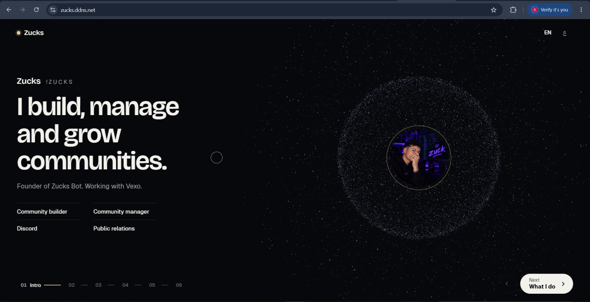

 

ZUCKS — Community Builder

An Interactive Portfolio Experience

A next-generation single-page portfolio built around a dynamic particle system that transforms into multiple interactive scenes.

 

🇬🇧 ENGLISH   |   🇪🇬 العربية

⸻

## Template-En

Overview

Zucks is an interactive personal portfolio template designed to deliver a completely different approach to digital identity and personal presentation.

At its core is a unified particle-based visual system: a single body of animated points that dynamically rearranges itself to form every scene.

Instead of traditional scrolling, static sections, or conventional page navigation, the entire experience operates through interactive states, creating a seamless journey between scenes.

One body of points. Multiple scenes. Zero traditional scrolling.

Key Features

* Particle-Based Visual Engine — A unified collection of animated points that dynamically transforms into different scenes.
* State-Driven Architecture — Every scene is an independent interactive state.
* Scroll-Free Experience — Navigate without conventional page scrolling.
* Interactive Navigation — Switch scenes through mouse clicks, keyboard input, and touch gestures.
* Dynamic Transitions — Smooth visual transformations between scenes.
* Desktop & Mobile Interaction — Supports keyboard, mouse, and swipe navigation.
* Bilingual Templates — Includes dedicated Arabic and English designs.
* Production Optimization — Bundled and obfuscated JavaScript with minified CSS.

Build & Run

Requirements

* Node.js
* npm
* Python 3.x

Installation

npm install

Production Build

npm run build

Bundles and obfuscates browser JavaScript into dist/, while minifying CSS.

Start Local Server

python serve.py

Local URL:

http://127.0.0.1:8765

Production & Deployment

The production build:

* Bundles browser-side JavaScript.
* Obfuscates JavaScript code.
* Minifies CSS assets.
* Excludes original js/ modules.
* Removes source maps from the served dist/ directory.

Security Note: JavaScript obfuscation makes browser code harder to read, but it does not prevent downloading or analyzing client-side assets.

Hosting Compatibility

Compatible with static servers supporting SPA rewrites, including:

* Nginx
* Node.js static servers
* Python HTTP servers
* Static hosting platforms

Important: ES modules require HTTP. Opening index.html directly through file:// is not supported.

The local server listens exclusively on 127.0.0.1:8765. Public traffic is proxied through a dedicated Nginx virtual host for zucks.ddns.net.

⸻

## Template-Ar

![Zucks English Template](./Template/zucks-ar.webp

نظرة عامة

Zucks هو قالب بورتفوليو شخصي تفاعلي يقدم أسلوبًا مختلفًا تمامًا لعرض الهوية الشخصية على الإنترنت.

يعتمد المشروع على نظام بصري موحد يتكون من مجموعة من النقاط المتحركة، والتي يعاد ترتيبها وتشكيلها ديناميكيًا لإنشاء مشاهد مختلفة.

بدلًا من التمرير التقليدي أو الأقسام الثابتة، تعتمد التجربة بالكامل على حالات تفاعلية يتم التنقل بينها بسلاسة.

مجموعة واحدة من النقاط. مشاهد متعددة. بدون تمرير تقليدي.

المميزات

* نظام النقاط المتحركة: إعادة تشكيل النقاط لإنشاء مشاهد بصرية مختلفة.
* نظام المشاهد التفاعلية: كل مشهد يمثل حالة مستقلة.
* بدون تمرير الصفحة: التنقل دون استخدام أسلوب Scroll التقليدي.
* طرق تنقل متعددة: باستخدام الماوس ولوحة المفاتيح واللمس.
* انتقالات ديناميكية: تحولات بصرية سلسة بين المشاهد.
* دعم الهواتف والكمبيوتر: تجربة تفاعلية لمختلف الأجهزة.
* تصميم ثنائي اللغة: قوالب عربية وإنجليزية.
* تحسين نسخة الإنتاج: تجميع وتشويش JavaScript وضغط CSS.

البناء والتشغيل

المتطلبات

* Node.js
* npm
* Python 3.x

تثبيت المكتبات

npm install

بناء نسخة الإنتاج

npm run build

يتم تجميع وتشويش ملفات JavaScript وإنشاء مجلد dist/ مع ضغط ملفات CSS.

تشغيل السيرفر المحلي

python serve.py

رابط التشغيل:

http://127.0.0.1:8765

الإنتاج والاستضافة

تتضمن نسخة الإنتاج:

* تجميع ملفات JavaScript.
* تشويش الكود البرمجي.
* ضغط ملفات CSS.
* استبعاد ملفات JavaScript الأصلية.
* إزالة Source Maps من نسخة الإنتاج.

ملاحظة أمنية: تشويش الكود يجعل قراءته أصعب، لكنه لا يمنع تحميل ملفات المتصفح أو تحليلها.

يدعم المشروع خوادم الاستضافة الثابتة التي تدعم SPA Rewrites مثل Nginx وNode.js Static Servers.

يجب تشغيل المشروع عبر HTTP، حيث إن فتح index.html مباشرة باستخدام file:// غير مدعوم.

السيرفر المحلي يستمع فقط على 127.0.0.1:8765، ويتم تمرير الاتصالات العامة عبر Nginx Virtual Host مخصص للنطاق zucks.ddns.net.

⸻

ZUCKS — Community Builder

One Experience. Endless Possibilities.

⸻

Template-En

Template-Ar

