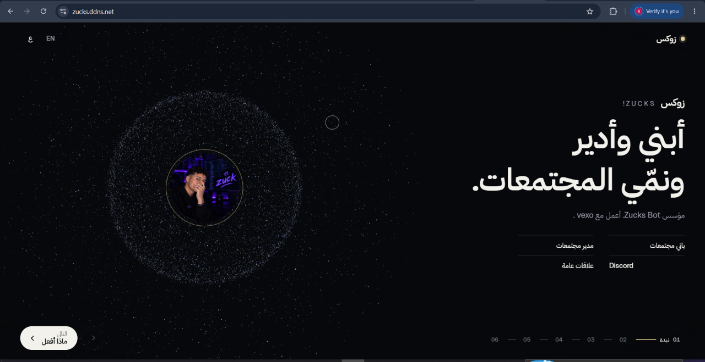

# Zucks — Community Builder

A single-page portfolio in the style of one body of points that rearranges
into every scene, no page scroll — scenes are states, changed by click, key or swipe.

## Build and run

```bash
npm install
npm run build            # bundles and obfuscates browser JavaScript into dist/
python serve.py           # http://127.0.0.1:8765 (serves dist/ when present)
```

The production build omits the original `js/` modules and source maps from the
served `dist/` directory, and bundles/minifies CSS. This only makes browser code
harder to read; anything sent to a browser can still be downloaded and studied.

Any static server with SPA rewrites works (`npx serve -s`, nginx `try_files`, etc.).
ES modules need HTTP — opening `index.html` via `file://` will not work.

The local server listens only on `127.0.0.1:8765`; public traffic is proxied by a
dedicated nginx virtual host for `zucks.ddns.net`.


## Template-En


## Template-Ar



